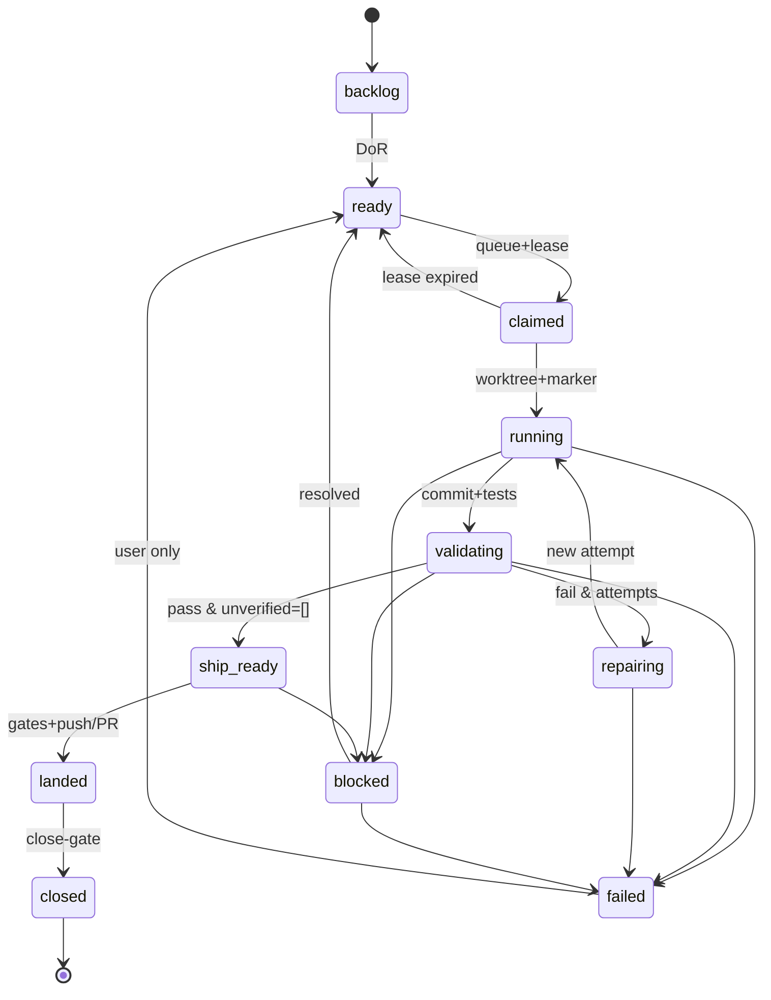

# 票状态机

> 细状态住本机 `task-state-<票>.json`，由状态转移脚本校验；GitHub 标签只是投影，不是状态正本。
> **两个文件别混**：`current-task-<票>.json` 是 scope-check 的租约/文件域槽位（既有；`allowed`/`baseline`/`active`），本状态机**不写**它；`task-state-<票>.json` 才是运行态（`state`/`attempt`/`contract_sha256`/`checkpoint`）。票面仍以 GitHub 为准；三方冲突先停手对账。
> 目的：让“票做到哪了”不依赖任何会话的记忆，也不允许执行体自称完成。

## 一、十一个状态

| 状态 | 含义 | 谁写 | GitHub 投影 |
|---|---|---|---|
| `backlog` | 已开票，合同不全或未排序 | Tower | open，无标签 |
| `ready` | 合同完整、依赖满足、可领 | Tower | open + `ready-for-agent` |
| `claimed` | 已发队列与租约，尚未开工 | Tower | 同上 |
| `running` | 执行体在工作，心跳新鲜 | Group | 同上（不频繁改标签） |
| `validating` | 实现完成，reviewer 正在逐条判 | Group | 同上 |
| `repairing` | 验收不过，还有尝试次数 | Group | 同上 |
| `ship_ready` | 验收通过，等 Ground 并车/出货 | Group | open；需要人工审查时加 `awaiting-acceptance` |
| `blocked` | 等人、等依赖、等外部条件 | 发现者 | open + `blocked` |
| `failed` | 尝试耗尽或致命错误，需人决策 | Coordinator/Group | open + `blocked` |
| `landed` | 已落地到 dev（或 PR 已合并） | Ground | open，等 close-gate |
| `closed` | 票面关闭，证据链完整 | Ground | closed |

`claimed` 与 `running` 分开：领了租约不等于开工；`running` 必须有工作树、marker 与心跳。

## 二、合法转移

| 从 | 到 | 守卫 | 写者 |
|---|---|---|---|
| backlog | ready | 过 DoR（`task-contract.md` §二） | Tower |
| ready | claimed | 队列已发、租约逐枚、文件域不重叠 | Tower |
| claimed | running | 租约有效、合同哈希一致、树+marker 就绪、心跳已写 | Group |
| claimed | ready | 租约释放或车道 stale 且未开工 | Tower |
| running | validating | 本地提交存在、定向测试已跑、检查点已存 | Group |
| validating | repairing | verdict=`fail`/`partial`，attempt < max | Group |
| repairing | running | 新 attempt、新上下文、合同未变 | Group |
| validating | ship_ready | verdict=`pass` 且 `unverified=[]` | Group |
| ship_ready | landed | handoff 有效、门通过、push/PR 合并成功 | Ground（P2 前＝持出货牌者） |
| ship_ready | blocked | 令牌被占/冲突/门红且需人处理 | Ground |
| landed | closed | close-gate 通过、票面留证、Issue 关闭 | Ground（P2 前＝持出货牌者） |
| 任意 | blocked | 有原因 + 可验证指针；不删已有证据 | 发现者（actor；改回 ready 只有 Tower/用户） |
| blocked | ready | 阻塞已解、合同未变或已重新批准 | Tower |
| 任意 | failed | attempt ≥ max，或同一错误 2 次，或致命错误 | Coordinator/Tower（P2 前 Group 可报，Tower 落） |
| failed | ready | **仅用户**明确恢复 | 用户（Tower 代记） |

**禁止：** 跳过 `validating` 直接 `ship_ready`；`running` 自己写 `closed`；同一票两个 owner 同时处于 `running`；`blocked` 自动过期。

## 二续、P2 前的写者座位

| 逻辑角色 | P2 前实际座位 | P2 后 |
|---|---|---|
| Tower | 主会话（塔台） | `on-duty-tower.json` |
| Ground | 持全局出货牌的主会话/出货者 | `on-duty-ground.json` |
| Coordinator | 主会话/哨兵 | `on-duty-coordinator.json` |
| Group-A/B | `on-duty-A.json`/`on-duty-B.json` | 同 |

`blocked` 可由任何发现者写事件；`blocked→ready` 只有 Tower/用户；`failed` 由 Coordinator 或 Tower 写。P2 前没有 Ground/Coordinator 独立座位时，由持出货牌的主会话代写；不新开第二个出货端口。

## 三、状态图



## 四、每次转移必须落事件

每次转移往 `events.jsonl` 追加一行（`schemas/event.schema.json`），至少带：

```json
{"schema":1,"event_id":"...","ts":"...","loop":"B","ticket":1854,"attempt":1,"actor":"group-a","from_state":"running","to_state":"validating","evidence":"commit abc1234; pytest 12 passed","result":"ok"}
```

没有事件的转移 = 没发生。Ground 关票前要能按票号重放出完整状态链。

## 五、与角色结果码的关系

角色状态卡仍用 `working/handoff/no-work/need-schedule/need-ship/blocked/need-user/stuck/done/partial/paused`（见 `playbooks/shifts/README.md`）。结果码是**这一班怎么收工**；票状态是**这张票在哪一步**。两者不能互相替代：

- Group 收工 `need-ship` ⇒ 那张票应当是 `ship_ready`。
- Group 收工 `partial` ⇒ 那张票应在 `repairing`/`validating`，不是 `closed`。
- Ground 收工 `done` ⇒ 本批票应是 `closed` 或明确 `blocked`。

## 六、恢复与对账

进程重启/换班后，按以下顺序恢复，不许直接信旧状态：

1. 读 `task-state-<票>.json` 与 `events.jsonl`，确认最后合法状态与 attempt。
2. 读 git 事实：分支是否存在、commit 是否可达、是否已并入 dev。
3. 读 GitHub：票是否 open/closed、是否有新评论/审批。
4. 三方冲突 ⇒ `blocked`，写清“哪三方不一致”，不自行猜。
5. 若状态是 `running` 但心跳超时：Coordinator 可写 `blocked`（reason=`stale-owner`），attempt 不自动加；新班接手时加 attempt 并开新上下文。

**旧检查点只是线索，不是真相。** 恢复时必须重跑当前阶段的验证命令。
